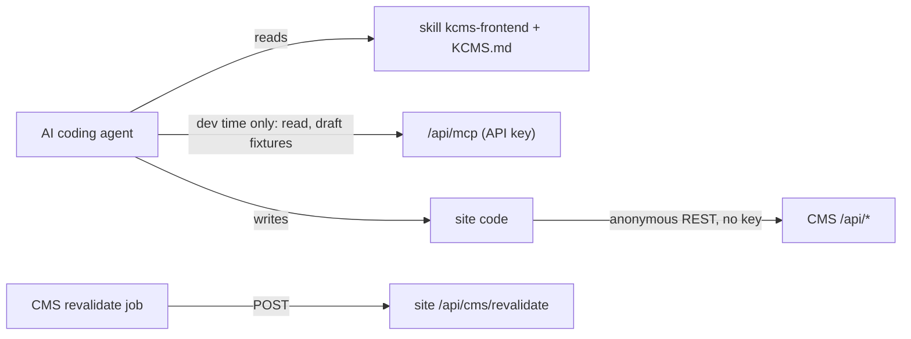

# Building a frontend with AI

How to point an AI coding agent (Claude Code, Codex, Cursor, Copilot, …) at KDIGI CMS and get a correct public website in Next.js, Astro, SvelteKit, Nuxt, React or Angular. Tiếng Việt: [frontend-with-ai.vi.md](frontend-with-ai.vi.md).

The CMS has no public site of its own. You (or your AI) build it on the REST contract in [rest-api.md](rest-api.md). This guide gives the agent everything it needs so it does not have to guess.

## Mental model



- The **site** reads the REST API **anonymously**. It never holds an API key: an authenticated read would return drafts.
- The **AI** may use the MCP tools or the `kcms` CLI while developing, to look at content and create draft fixtures. That uses your editor API key in your shell, never in the site code.
- When content changes, the CMS calls `POST https://{Sites.domain}/api/cms/revalidate`; the site refreshes its cache.

## Three steps

1. **Install the CLI and the skills** in the frontend repo (an empty folder is fine):

   ```bash
   npm install -g @kdigi/kcms-cli
   export KCMS_API_KEY=…            # optional: only for dev-time MCP access, never in the site
   kcms setup claude-code --write --with-skill kcms,kcms-frontend --url https://cms.example.com
   ```

   Other tools: `codex`, `cursor`, `vscode`, `omp`, `json` ([ai-integration.md](ai-integration.md#2-connect-a-client)). Without `KCMS_API_KEY` exported, the MCP config is still written but the agent cannot use it; the site does not need it. To install only the skill without the CLI, copy the [`skills/kcms-frontend`](../skills/kcms-frontend) folder into your tool's skills directory.

2. **Write the site facts** to `KCMS.md` (anonymous, no key needed, safe to commit):

   ```bash
   kcms frontend context --url https://cms.example.com --site example-site
   ```

   It contains the site id, domain, locales, menus, page mapping (`pageGroup`), published counts, trimmed sample documents, routes and the webhook URL. Add the line `Read KCMS.md before working on CMS data.` to your `AGENTS.md` or `CLAUDE.md`. Regenerate it with `--force` after changing site settings.

3. **Prompt** the agent. One sentence is enough; the skill carries the rules.

## Prompt templates

| Framework | Prompt |
| --- | --- |
| Next.js | `Build a Next.js (App Router) website for the KDIGI CMS site example-site. Follow the kcms-frontend skill and KCMS.md.` |
| Astro | `Build an Astro website for the KDIGI CMS site example-site, static output with a rebuild on the CMS webhook. Follow the kcms-frontend skill and KCMS.md.` |
| SvelteKit | `Build a SvelteKit website for the KDIGI CMS site example-site. Follow the kcms-frontend skill and KCMS.md.` |
| Nuxt | `Build a Nuxt website for the KDIGI CMS site example-site. Follow the kcms-frontend skill and KCMS.md.` |
| React | `Build a React + Vite website for the KDIGI CMS site example-site, prerendered for SEO. Follow the kcms-frontend skill and KCMS.md.` |
| Angular | `Build an Angular SSR website for the KDIGI CMS site example-site. Follow the kcms-frontend skill and KCMS.md.` |

Follow-ups that work well:

- `Add English under /en, following the kcms-frontend skill.`
- `Add comments under each post using the CMS comments endpoint.`
- `Add a search page.`
- `Add category and tag archive pages.`
- `Run the kcms-frontend checklist and fix what fails.`

## Without the CLI

Give the agent the CMS URL and tell it to read `https://cms.example.com/llms.txt` (index) or `https://cms.example.com/llms-full.txt` (the skill, the contract digest, the REST and SEO docs in one file). Both are served by every KDIGI CMS instance and match its version. Then give it the `siteKey`; it can resolve the rest from `GET /api/sites?where[siteKey][equals]=example-site`.

## Common AI mistakes

| Symptom | Cause | Fix |
| --- | --- | --- |
| Drafts or scheduled posts visible on the site | Requests carry an `Authorization` header or cookies (often an API key copied into `.env`) | Remove all auth from site requests; delete the key from the site's env |
| Posts from another site show up | Missing `where[tenant][equals]=<site id>` | Route every query through one helper that adds the tenant filter |
| Pages stay stale after publishing | No `/api/cms/revalidate` handler, wrong `Sites.domain`, or jobs not running | Implement the webhook; set `domain` to the site host; `ENABLE_JOBS_AUTORUN=true` on one CMS instance |
| "View on site" in the admin opens a 404 | The site's routes differ from `publicPathFor` | Use `/{slug}` (landing → page → post) and `/product/{slug}`, or change `src/lib/frontend-public-path.ts` |
| Raw Markdown (`##`, `**`) on the page | Rendering `contentMd`, or escaping `content` | Render `content` as HTML; never use `*Md` fields |
| Empty `<title>` / no meta description | `seo.title` is empty by design | Resolve with `Sites.seoTitles` templates, then title/excerpt ([seo.md](seo.md#resolving-on-the-frontend)) |
| JSON-LD invalid or duplicated | `seo.jsonLd.raw` wrapped in another `<script>` | Inject the string verbatim; it is already a full `<script>` element |
| Content via GraphQL shows JSON instead of HTML | GraphQL returns raw storage | Use REST |

## Deploy checklist

- `Sites.domain` is the site's real host name (no scheme). The CMS posts to `https://{domain}/api/cms/revalidate`, so it must be reachable over HTTPS from the CMS.
- `ENABLE_JOBS_AUTORUN=true` on exactly one CMS instance ([configuration.md](configuration.md)).
- Site env: CMS URL and `siteKey` only. No API key.
- Allow the CMS host (and the site's R2/CDN host, if any) in the framework's image configuration.
- Optional: rate-limit `/api/cms/revalidate` at your edge; the CMS request is unauthenticated.
- If the site uses other routes than the convention, update `publicPathFor` on the CMS before editors start using "View on site" and internal links.

## For CMS contributors

The skill (`skills/kcms-frontend/`) and `/llms-full.txt` repeat the REST contract. When you change [rest-api.md](rest-api.md) or [seo.md](seo.md), update the skill and run `pnpm generate:llms`; `pnpm test` fails while `public/llms*.txt` is stale.
