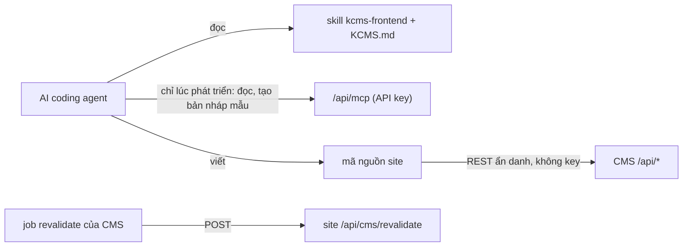

# Xây frontend bằng AI

Cách giao cho một AI coding agent (Claude Code, Codex, Cursor, Copilot, …) làm website công khai trên KDIGI CMS bằng Next.js, Astro, SvelteKit, Nuxt, React hoặc Angular, và nhận về một site làm đúng hợp đồng API. English: [frontend-with-ai.md](frontend-with-ai.md).

CMS không có site công khai riêng. Bạn (hoặc AI của bạn) dựng site dựa trên hợp đồng REST trong [rest-api.md](rest-api.md). Hướng dẫn này cung cấp cho agent mọi thứ nó cần để khỏi phải đoán.

## Mô hình



- **Site** đọc REST API **ẩn danh**. Site không bao giờ giữ API key: một request có xác thực sẽ trả về cả bản nháp.
- **AI** có thể dùng MCP tool hoặc CLI `kcms` trong lúc phát triển để xem nội dung và tạo bản nháp làm dữ liệu mẫu. Việc đó dùng API key biên tập viên trong shell của bạn, không bao giờ nằm trong mã site.
- Khi nội dung thay đổi, CMS gọi `POST https://{Sites.domain}/api/cms/revalidate`; site làm mới cache.

## Ba bước

1. **Cài CLI và skill** trong repo frontend (thư mục trống cũng được):

   ```bash
   npm install -g @kdigi/kcms-cli
   export KCMS_API_KEY=…            # tuỳ chọn: chỉ để AI dùng MCP lúc phát triển, không bao giờ đưa vào site
   kcms setup claude-code --write --with-skill kcms,kcms-frontend --url https://cms.example.com
   ```

   Công cụ khác: `codex`, `cursor`, `vscode`, `omp`, `json` ([ai-integration.md](ai-integration.md#2-connect-a-client)). Không export `KCMS_API_KEY` thì cấu hình MCP vẫn được ghi nhưng agent không dùng được; site thì không cần key. Muốn cài riêng skill mà không dùng CLI, chép thư mục [`skills/kcms-frontend`](../skills/kcms-frontend) vào thư mục skills của công cụ.

2. **Ghi thông tin site** ra `KCMS.md` (ẩn danh, không cần key, commit được):

   ```bash
   kcms frontend context --url https://cms.example.com --site example-site
   ```

   File chứa id site, domain, ngôn ngữ, menu, ánh xạ trang (`pageGroup`), số lượng nội dung đã đăng, tài liệu mẫu rút gọn, quy tắc route và URL webhook. Thêm dòng `Read KCMS.md before working on CMS data.` vào `AGENTS.md` hoặc `CLAUDE.md`. Chạy lại với `--force` sau khi đổi cấu hình site.

3. **Ra lệnh** cho agent. Một câu là đủ; skill đã mang các quy tắc.

## Mẫu prompt

| Framework | Prompt |
| --- | --- |
| Next.js | `Build a Next.js (App Router) website for the KDIGI CMS site example-site. Follow the kcms-frontend skill and KCMS.md.` |
| Astro | `Build an Astro website for the KDIGI CMS site example-site, static output with a rebuild on the CMS webhook. Follow the kcms-frontend skill and KCMS.md.` |
| SvelteKit | `Build a SvelteKit website for the KDIGI CMS site example-site. Follow the kcms-frontend skill and KCMS.md.` |
| Nuxt | `Build a Nuxt website for the KDIGI CMS site example-site. Follow the kcms-frontend skill and KCMS.md.` |
| React | `Build a React + Vite website for the KDIGI CMS site example-site, prerendered for SEO. Follow the kcms-frontend skill and KCMS.md.` |
| Angular | `Build an Angular SSR website for the KDIGI CMS site example-site. Follow the kcms-frontend skill and KCMS.md.` |

Prompt tiếng Việt cũng được, ví dụ: `Làm website Next.js cho site example-site trên KDIGI CMS, theo skill kcms-frontend và KCMS.md.`

Các yêu cầu tiếp theo hay dùng:

- `Add English under /en, following the kcms-frontend skill.`
- `Add comments under each post using the CMS comments endpoint.`
- `Add a search page.`
- `Add category and tag archive pages.`
- `Run the kcms-frontend checklist and fix what fails.`

## Không dùng CLI

Đưa agent URL của CMS và bảo nó đọc `https://cms.example.com/llms.txt` (mục lục) hoặc `https://cms.example.com/llms-full.txt` (skill, bản tóm tắt hợp đồng, tài liệu REST và SEO trong một file). Mọi bản cài KDIGI CMS đều phục vụ hai file này, đúng với phiên bản đang chạy. Sau đó đưa `siteKey`; agent tự tra phần còn lại qua `GET /api/sites?where[siteKey][equals]=example-site`.

## Lỗi AI hay mắc

| Triệu chứng | Nguyên nhân | Cách sửa |
| --- | --- | --- |
| Bài nháp hoặc bài hẹn giờ hiện trên site | Request có header `Authorization` hoặc cookie (thường do chép API key vào `.env`) | Bỏ mọi xác thực khỏi request của site; xoá key khỏi env của site |
| Hiện bài của site khác | Thiếu `where[tenant][equals]=<id site>` | Cho mọi truy vấn đi qua một helper luôn thêm bộ lọc tenant |
| Trang không cập nhật sau khi đăng | Không có handler `/api/cms/revalidate`, `Sites.domain` sai, hoặc job không chạy | Làm webhook; đặt `domain` đúng host của site; `ENABLE_JOBS_AUTORUN=true` trên một instance CMS |
| "Xem trên site" trong admin ra 404 | Route của site khác `publicPathFor` | Dùng `/{slug}` (landing → page → post) và `/product/{slug}`, hoặc sửa `src/lib/frontend-public-path.ts` |
| Trang hiện Markdown thô (`##`, `**`) | Render `contentMd`, hoặc escape `content` | Render `content` dạng HTML; không dùng các field `*Md` |
| `<title>` trống / thiếu meta description | `seo.title` để trống là chủ ý | Ghép từ mẫu `Sites.seoTitles`, rồi tới tiêu đề/tóm tắt ([seo.md](seo.md#resolving-on-the-frontend)) |
| JSON-LD lỗi hoặc bị lặp | Bọc `seo.jsonLd.raw` trong một `<script>` khác | Chèn nguyên chuỗi; nó đã là một thẻ `<script>` hoàn chỉnh |
| Lấy qua GraphQL ra JSON thay vì HTML | GraphQL trả dữ liệu lưu trữ thô | Dùng REST |

## Checklist triển khai

- `Sites.domain` là host thật của site (không có scheme). CMS gửi tới `https://{domain}/api/cms/revalidate`, nên CMS phải gọi được qua HTTPS.
- `ENABLE_JOBS_AUTORUN=true` trên đúng một instance CMS ([configuration.md](configuration.md)).
- Env của site: chỉ URL CMS và `siteKey`. Không có API key.
- Cho phép host CMS (và host R2/CDN của site nếu có) trong cấu hình ảnh của framework.
- Tuỳ chọn: giới hạn tần suất `/api/cms/revalidate` ở edge; request từ CMS không có xác thực.
- Nếu site dùng route khác quy ước, sửa `publicPathFor` trên CMS trước khi biên tập viên dùng "Xem trên site" và link nội bộ.

## Cho người đóng góp vào CMS

Skill (`skills/kcms-frontend/`) và `/llms-full.txt` lặp lại hợp đồng REST. Khi sửa [rest-api.md](rest-api.md) hoặc [seo.md](seo.md), cập nhật skill và chạy `pnpm generate:llms`; `pnpm test` sẽ lỗi khi `public/llms*.txt` lỗi thời.
