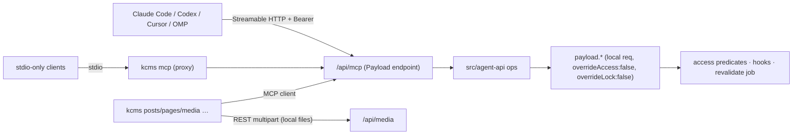

# AI-native KDIGI CMS: MCP server + kcms CLI

## Overview

Make KDIGI CMS AI-native without a second auth system or a second data path:

- **MCP server** — Payload custom endpoint `POST /api/mcp` (stateless Streamable HTTP, `@modelcontextprotocol/sdk` `WebStandardStreamableHTTPServerTransport`). 23 curated, LLM-friendly tools (Markdown in/out, compact JSON), plus 1 resource + 2 prompts + server `instructions`.
- **Auth** — existing `users.auth.useAPIKey` (`src/collections/users.ts:73`). Header-only: `Authorization: Bearer <key>` (what MCP clients send) or Payload-native `users API-Key <key>`; cookie sessions rejected. Every op runs as the key owner on an isolated Local-API request with `overrideAccess:false` + `overrideLock:false`; public-read collections (sites, media) and all relationship ids are explicitly tenant-checked.
- **Operations core** — `src/agent-api/` functions over `(ctx, input)` with strict per-collection zod schemas; MCP tools are thin adapters. Mandatory optimistic concurrency (`expectedUpdatedAt` + row lock), soft-trash/untrash, legacy-body protection.
- **Hardening of existing surfaces** — api-key sessions cannot change credentials or permanently delete via REST; `auto-fill-excerpt` / `apply-seo-templates` stop clobbering data on partial updates; media-from-URL gets a DNS-pinned fetch (both paths) + image MIME allow-list (agent path).
- **CLI** — new pnpm workspace package `packages/kcms-cli` → npm `@kdigi/kcms-cli`, binary `kcms`. Thin MCP *client* of `/api/mcp` (zero duplicate business logic) + REST multipart for local file upload + `kcms mcp` stdio↔HTTP proxy + `kcms setup <client>` config writer.
- **Agent guidance** — `skills/kcms/SKILL.md` (Agent Skills format: Claude Code, Codex, OMP, Cursor), `docs/ai-integration.md`, README section.

Decisions (user, 2026-11-03): scope HOLD · custom endpoint + SDK (not `@payloadcms/plugin-mcp`) · OAuth 2.1 / ChatGPT-web / Claude.ai-web connectors DEFERRED to a separate plan · CLI package name `@kdigi/kcms-cli`, command `kcms`.

## Not in scope

- OAuth 2.1 authorization server / dynamic client registration (ChatGPT web, Claude.ai web) — follow-up plan.
- Per-key scopes / read-only keys (keys inherit the owner's role; issue dedicated low-role users instead).
- Exposing users, site settings, comments, ratings, redirects, menus, products, landings, shortcode editing (read-only `list_shortcodes` only), permanent delete.
- Built-in rate limiting (reverse proxy, consistent with existing public endpoints).

## Phases

| Phase | Name | Status |
|-------|------|--------|
| 1 | [Agent operations core and API-key auth](./phase-01-agent-operations-core-and-api-key-auth.md) | Completed |
| 2 | [MCP endpoint at /api/mcp](./phase-02-mcp-endpoint-at-api-mcp.md) | Completed |
| 3 | [kcms CLI package](./phase-03-kcms-cli-package.md) | Completed |
| 4 | [Agent skill and client setup docs](./phase-04-agent-skill-and-client-setup-docs.md) | Completed |
| 5 | [Integration tests and real-client smoke](./phase-05-integration-tests-and-real-client-smoke.md) | Completed |

## Dependencies

- No other plans in `./plans/` (first plan).
- New runtime deps (root): `@modelcontextprotocol/sdk@^1.32` (zod `^3.25 || ^4` peer — repo has zod 4.6), `undici` (DNS-pinned fetch for media import).
- New workspace: `pnpm-workspace.yaml` (`packages/*`); Dockerfile `deps` stage must copy it + `packages/*/package.json`.
- Phase order: 1 → 2 → 3 → 4 → 5 (Phase 4 depends on Phase 3: CLI bundles the skill).

## Red Team Review

### Session — 2026-11-03
**Findings:** 15 consolidated from 29 raw (15 accepted, 0 rejected) — reviewers: Security Adversary, Failure Mode Analyst, Assumption Destroyer; all evidence-backed (repo + `node_modules/payload@3.90.2`).
**Severity breakdown:** 1 Critical, 10 High, 4 Medium

| # | Finding | Severity | Disposition | Applied To |
|---|---------|----------|-------------|------------|
| 1 | Local API defaults `overrideLock=true` → locks ignored and deleted; restoreVersion unchecked | Critical | Accept | Completed |
| 2 | API key is a full-account credential on all REST routes (password change, hard delete) | High | Accept | Completed |
| 3 | `expectedUpdatedAt` optional + non-atomic | High | Accept | Completed |
| 4 | Shared HTTP `req`/transaction across concurrent/batched tool calls; fake body cap | High | Accept | Completed |
| 5 | Partial updates clobber excerpt + `seo.breadcrumbs` via hooks | High | Accept | Completed |
| 6 | Cross-tenant ids; sites/media are public-read | High | Accept | Phase 1 (rule 5, filtered list/search), Phase 5 #4-5 |
| 7 | Trash mechanism unspecified; no untrash | High | Accept | Phase 1 (`trash_content`, `restore_from_trash`), Phase 3, Phase 5 #19 |
| 8 | Legacy Lexical-only body blanked by get/update round-trip | High | Accept | Phase 1 (rule 7), Phase 3 (`--ack-legacy`, `--clear-body`), Phase 5 #17 |
| 9 | Media-from-URL widened: DNS rebinding, arbitrary MIME, `overrideAccess:true` | High | Accept | Phase 1 (media import hardening), Phase 5 #22 |
| 10 | Plain-Error author ban / raw 23505 slug errors → opaque `internal` | High | Accept | Phase 1 (`errors.ts`, slug pre-check, hook → `APIError 403`), Phase 5 #8, #18 |
| 11 | Pages modeled with post-only fields; non-strict schemas drop data silently | High | Accept | Phase 1 (strict per-collection schemas), Phase 3 frontmatter, Phase 5 #15, #27 |
| 12 | Preview URL dead for drafts, env-first host, siteKey/id ambiguity | Medium | Accept | Phase 1 (`get_content_urls`, site resolution), Phase 2/4 workflow |
| 13 | Taxonomy slug ambiguous across types | Medium | Accept | Phase 1 (rule 6), Phase 3 frontmatter, Phase 5 #21 |
| 14 | Scheduling (`publishedAt`) invisible; "published" ≠ live | Medium | Accept | Phase 1 (`publishedAt`, `live`), Phase 2 instructions, Phase 5 #9 |
| 15 | REST afterRead render + re-auth on every agent read | Medium | Accept | Phase 1 (local req, `select`, auth reuse) |

Also applied (consistency): `Sites` has `defaultLanguage` not `locales`; `fallbackLocale:false` + `translated`; shortcodes are per-tenant DB rows → `list_shortcodes`; `seo_audit` scoped to posts/pages + new `get_seo_report`; optional `author`; tool count fixed at 23; harness gains API keys, multi-site user, cleanup, `callMcp`; `MCP_ENABLED` passed through Coolify compose; eslint ignore `packages/**/dist/**`; CI builds/packs CLI; Phase 4 now after Phase 3; `claude mcp add` argv key leak avoided via `.mcp.json` env expansion; OMP config format confirmed (`.omp/mcp.json`, `${VAR}` expansion).

### Whole-Plan Consistency Sweep
- Decision deltas checked across plan.md + phases 1–5: tool count (23 everywhere: Phase 1 table, Phase 2 annotations/success criteria), `get_preview_url` → `get_content_urls`, `format: html` dropped, `locales` → `defaultLanguage`, required `expectedUpdatedAt` (Phase 1 ops, Phase 2 instructions, Phase 3 CLI flows, Phase 4 skill, Phase 5 #12-13), trash via `update{deletedAt}` + `restore_from_trash` (Phases 1/2/3/5), `overrideLock:false` (Phases 1/5, CLAUDE.md update in Phase 4), phase order 1→2→3→4→5 (plan.md, phase frontmatter `dependencies`).
- Grep for stale terms (`19`, `~18`, `get_preview_url`, `previewUrl`, `format: markdown`, `3 ∥ 4`, `never exposed`, `(req, input)`): zero stale hits.
- Unresolved contradictions: **0**.

## Validation Log

### Session 1 — 2026-11-03
**Trigger:** user chose `/ck:plan validate` after red-team review.
**Questions asked:** 8. Verification pass was skipped because the Red Team Review already holds file:line evidence; there were no `[UNVERIFIED]` tags.

#### Questions & Answers
1. **[Assumptions]** What should `MCP_ENABLED` default to when the operator does not set it?
   - Options: true (on by default) | false (opt-in)
   - **Answer:** true
   - **Rationale:** the endpoint is AI-native out of the box and still needs an API key per user.
2. **[Architecture]** Where should the API-key session hardening apply?
   - Options: all of REST/GraphQL | only /api/mcp
   - **Answer:** all of REST/GraphQL
   - **Rationale:** a leaked key must not allow account takeover or a hard delete on any route. This is a documented behavior change.
3. **[Risks]** Should super-admin keys work over /api/mcp?
   - Options: allow + warn | block (403)
   - **Answer:** allow + warn
   - **Rationale:** operators manage many sites from AI tools. The risk is surfaced in `whoami` and in the logs.
4. **[Scope]** How should /api/mcp be rate-limited?
   - Options: reverse proxy | in-app per-user
   - **Answer:** reverse proxy
   - **Rationale:** consistent with the existing public endpoints, and an in-memory limiter is wrong with multiple replicas.
5. **[Tradeoffs]** How should AI edits to legacy Lexical-only bodies be handled?
   - Options: convert + ack | forbid body edits
   - **Answer:** convert + ack
6. **[Assumptions]** Should `expectedUpdatedAt` be required on writes?
   - Options: required | optional
   - **Answer:** required
7. **[Scope]** How should `@kdigi/kcms-cli` be published to npm?
   - Options: CI on tag | manual | don't publish yet
   - **Answer:** manual
8. **[Architecture]** Fix `auto-fill-excerpt`/`apply-seo-templates`, which also affect REST clients, or do read-modify-write only in agent-api?
   - Options: fix the hooks | read-modify-write in agent-api
   - **Answer:** fix the hooks

#### Confirmed Decisions
- MCP is on by default; `MCP_ENABLED=false` is the kill switch.
- API-key hardening applies globally and is noted as a behavior change in CHANGELOG.
- Super-admin keys are allowed, with a warning.
- Rate limiting is left to the reverse proxy.
- Legacy bodies convert with explicit acknowledgement.
- CAS (`expectedUpdatedAt`) is mandatory.
- npm publishing is manual.
- The hooks get fixed at the root.

#### Impact on Phases
- Phase 1: super-admin warning in `whoami` and logs.
- Phase 3: manual release procedure in the CLI README; no publish workflow.
- Phase 4: CHANGELOG behavior-change wording.
- Phases 2 and 5 were already consistent.

### Whole-Plan Consistency Sweep
- Checked all three propagated edits against every phase:
  - Phase 3 CI only builds and packs; there is no publish step.
  - Phase 2 keeps `MCP_ENABLED` defaulting to `true`.
  - Phase 5 #23 covers the global REST hardening.
  - Super-admin access is not blocked anywhere.
- Unresolved contradictions: **0**. Verification `Failed: 0` → eligible for `/ck:cook`.
