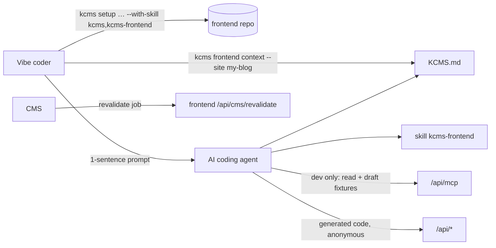

# AI frontend guide: kcms-frontend skill, llms.txt, kcms frontend context

## Overview

Brainstorm: [../reports/brainstorm-261104-frontend-ai-guide.md](../reports/brainstorm-261104-frontend-ai-guide.md) (approved 2026-11-04).

Problem: AI coding agents building a public site on KDIGI CMS guess the REST contract → drafts leak (auth header), wrong tenant/locale, no `/api/cms/revalidate` webhook, routes that break "View on site". Existing MCP/CLI/skill (`skills/kcms`) serve **editorial** agents only.

Deliverables:
- `skills/kcms-frontend/` (EN): framework-agnostic rules + references `nextjs`, `astro`, `sveltekit`, `nuxt`, `spa`, `checklist`.
- `kcms frontend context` → `KCMS.md` with site-specific facts, anonymous REST only, never a key.
- `kcms setup <target> --with-skill [kcms,kcms-frontend]` (bare flag = `kcms`, backward compatible); package bundles both skills.
- `/llms.txt` + `/llms-full.txt` served from `public/` on the CMS host.
- `docs/frontend-with-ai.md` bilingual + README/ai-integration/rest-api/CLI README/CHANGELOG.
- Extended demo seed (draft post, home page, `pageGroup`) for realistic frontend dev and smoke.
- End-to-end Claude Code smoke: Next.js, Astro, SvelteKit, Nuxt, React + Vite prerender, Angular SSR (6 runs).

Decisions (user, 2026-11-04): approach B (no SDK, no starters) · references for all 5 framework families · skill EN, guide bilingual · MCP at dev time: read + draft only, never publish, never key in frontend code · smoke all 5 frameworks.

Plan-time refinement (vs brainstorm §4.2): llms files are **generated by a script and committed** to `public/`, guarded by a drift test in `pnpm test`, instead of a `pnpm build` step. Reason: `next build` already skips lint/typecheck on small hosts and the Docker builder copies `public/` as-is; a committed file + drift test is deterministic and adds no build-time work.

Out of scope: SDK `@kdigi/kcms-client`, starter templates, MCP OAuth, per-site llms.txt, new MCP tools, REST contract changes.

## Phases

| Phase | Name | Status |
|-------|------|--------|
| 1 | [Frontend skill and framework references](./phase-01-frontend-skill-and-framework-references.md) | Completed |
| 2 | [kcms frontend context command](./phase-02-kcms-frontend-context-command.md) | Completed |
| 3 | [Multi-skill setup and bundling](./phase-03-multi-skill-setup-and-bundling.md) | Completed |
| 4 | [llms.txt generation and drift test](./phase-04-llms-txt-generation-and-drift-test.md) | Completed |
| 5 | [Bilingual docs and changelog](./phase-05-bilingual-docs-and-changelog.md) | Completed |
| 6 | [Five-framework agent smoke](./phase-06-five-framework-agent-smoke.md) | Completed — 6/6 pass, [report](./reports/smoke-report.md) |

Order: 1 → (2 ∥ 3) → 4 (embeds skill) → 5 → 6. Phase 6 may send fixes back to 1/2.

## Dependencies

- Builds on completed plan `261103-1600-ai-native-mcp-cli` (MCP endpoint, CLI, `skills/kcms`). No unfinished overlapping plans.
- Phase 6 needs local Postgres, `pnpm migrate`, `pnpm seed:demo`, an `editor` user API key on the demo site, and Claude Code CLI.

## Global acceptance

- `pnpm lint && pnpm typecheck && pnpm test` green.
- All phase success criteria checked; phase 6 report saved under `reports/`.

## Validation Log

### Session 1 — 2026-11-04

Questions asked: 4.

| Topic | Decision | Propagated |
|---|---|---|
| Demo seed lacks draft post + `FRONT_PAGE` pageGroup | Extend `src/seed/seed-demo.ts` (home page `trang-chu`, 1 draft post, pageGroup FRONT_PAGE/ABOUT/CONTACT written only when empty) | phase 6 step 0 |
| Route convention | Recommend (not mandate) catch-all `/{slug}` landing → page → post + `/product/{slug}`; deviation requires telling user to edit `publicPathFor` | phase 1 §Routes, phase 6 check 7 |
| SPA smoke target | Both React + Vite prerender and Angular SSR (6 runs) | phase 6 |
| Smoke agent | Claude Code headless | phase 6, Dependencies |
| http warning in `context` (verification failure) | Dropped: warning in `runtime.ts` protects the key; command sends none | phase 2 |

### Verification Results
- Claims checked: 28
- Verified: 24 | Failed: 4 | Unverified: 0 (all 4 resolved above)
- Tier: Full
- Failures:
  - `src/seed/seed-demo.ts:11-12` — seed has only published posts, no `pageGroup` → resolved (extend seed).
  - `src/lib/frontend-public-path.ts:6` — catch-all resolution order missing from plan → resolved.
  - `packages/kcms-cli/src/runtime.ts:21` — http warning location/purpose → resolved (dropped).
  - `src/seed/seed-demo.ts:310` — site `domain: 'localhost'` → webhook job cannot reach frontend dev port; phase 6 uses manual call + job log.
- Verified highlights: `resolveConnection` requires a key (`config.ts:86`) → key-less resolver needed; `packages/kcms-cli/package.json` `files` includes `skills`; commander ^14; `src/scripts/` exists; `next.config.ts` only redirects `/` → `/llms.txt` served from `public/`; endpoint paths `/comments/create`, `/ratings/submit`, `/:siteKey/env-page`, `/frontend-doc-url`; `agent-op` log in `src/agent-api/index.ts:43`; `fallback-locale=none`; `seo.jsonLd.raw` is a full `<script>` element (inject verbatim, do not wrap).

### Whole-Plan Consistency Sweep
- Searched plan + brainstorm for: "5 framework", "OMP", "Angular or React", "pnpm build", "5/5", http warning.
- Fixed: plan.md deliverables + Dependencies; phase 6 title/requirements/checks/steps/criteria; brainstorm report keeps original "5 framework" wording as historical record (superseded by this log).
- Unresolved contradictions: **0**. Verification failures all resolved → eligible for `/ck:cook`.
